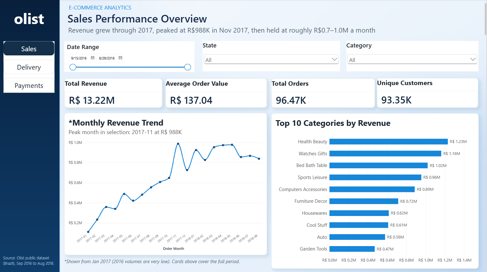
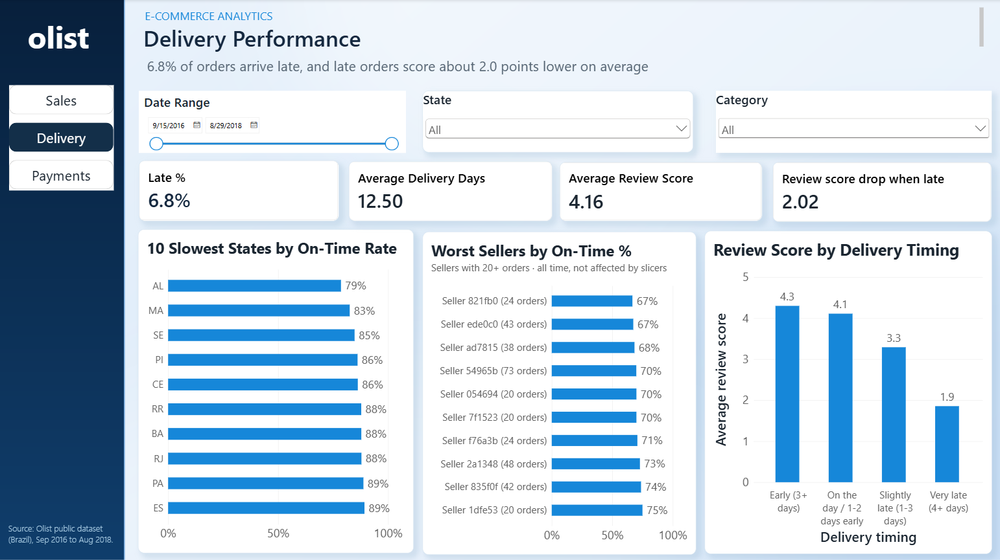
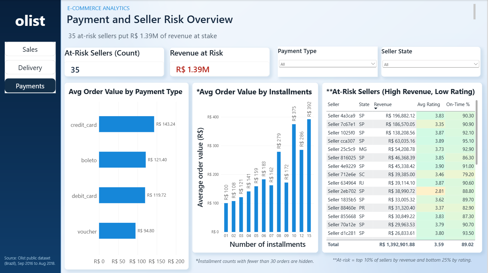
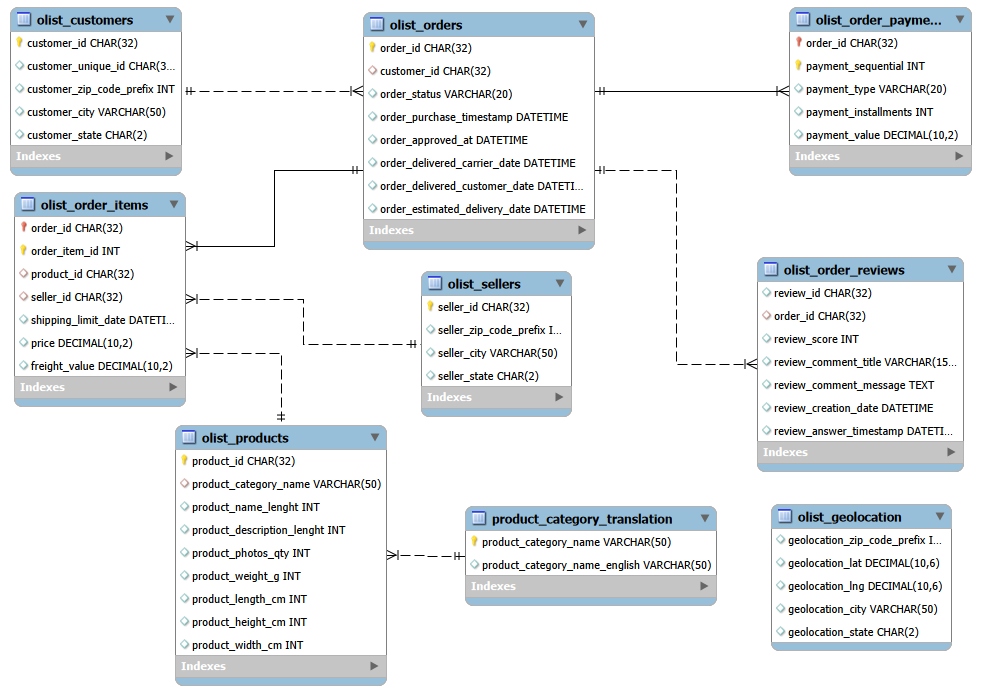

# E-Commerce Sales & Delivery Analysis (Olist)

> Analysed 96K delivered orders (R$13.2M) and found that late deliveries are linked to review scores about 2 points lower (4.29 to 2.27), and that 35 high-revenue sellers with below-par ratings account for R$1.39M of revenue.

An end-to-end analytics project on a Brazilian e-commerce marketplace: raw CSVs → MySQL → Power BI dashboards → business recommendations.

**Tools:** MySQL 8.0 (SQL views, window functions) · Power BI Desktop (3-page dashboard)
**Data:** [Olist Brazilian E-Commerce Public Dataset](https://www.kaggle.com/datasets/olistbr/brazilian-ecommerce) (Kaggle), Sep 2016 to Aug 2018, ~100k orders

## Business problem

Olist connects small sellers to customers across Brazil. Delivery reliability and seller quality drive customer satisfaction, and therefore repeat business. This project answers:

1. How are revenue and orders trending, and which categories drive them?
2. How often are orders late, where, and does lateness hurt reviews?
3. Which high-revenue sellers are putting the platform's reputation at risk?

## Dashboards

**Sales Performance Overview**


**Delivery Performance**


**Payment and Seller Risk Overview**


## Key findings

All money is in Brazilian reals (R$). Revenue = item price only (freight excluded). Impact figures are illustrative estimates, not audited numbers.

**Headline:** R$13.22M revenue across 96,470 delivered orders (average order R$137.04). Orders take 12.5 days on average to arrive, 11.9 days earlier than estimated, and 93.2% arrive on or before the estimated date.

### 1. Late delivery is strongly linked to bad reviews
Late orders are only 6.8% of volume (6,534 orders), but they score about 2 points lower: **4.29 on-time vs 2.27 late**.
**Recommendation:** treat any order that passes its estimated date as a service-recovery case (proactive message, fast support contact, or a voucher).
**Estimated impact:** late orders represent about R$0.99M of revenue; retaining 10% of those customers protects about **R$99k** (assumption: 10% retention uplift).

### 2. Late deliveries are worst in the North-East, but Rio de Janeiro drives the volume
Alagoas (78.6% on-time), Maranhão (82.6%) and Sergipe (84.8%) have the lowest on-time rates against a 93.2% average. Rio de Janeiro (87.9% on-time across 12,350 orders) produces about 1,500 late orders, roughly a quarter of all late deliveries.
**Recommendation:** fix carrier performance in RJ first (biggest volume impact), then review logistics partners in AL and MA.
**Estimated impact:** lifting RJ to the 93.2% average removes about 650 late orders, roughly **R$90-98k** of revenue no longer exposed to the review penalty.

### 3. 35 high-revenue sellers have below-par ratings, and most also deliver late
35 sellers are in the top 10% by revenue but the bottom 25% by rating. Together they generate **R$1.39M (11.0% of seller revenue)**, with an average rating of 3.59 and an average on-time rate of 89.0% (platform: 93.2%). 22 of the 35 are below the platform on-time rate; the other 13 deliver on time, so their problem is ratings rather than logistics.
**Recommendation:** put them on a performance plan (93% on-time target, 4.0 minimum rating), starting with sellers that miss both; review product quality and listings for the 13 that already deliver on time.
**Estimated impact:** raising their on-time rate from 89.0% to 93.2% moves about **R$58k** out of the late-delivery group.

The three estimates overlap, so they should not be added together. Full write-up in [`findings.md`](findings.md).

### Other observations
- **Sales trend:** monthly revenue grew through 2017, peaked at R$988K in November 2017, then held between roughly R$0.7M and R$1.0M a month through August 2018.
- **Payments:** average order value tends to increase with the number of installments (counts are small at high installment numbers; about R$100 for 1 installment, R$392 for 15) and is highest for credit card (R$143.24) and lowest for voucher (R$94.80). This is an association, not a causal effect.

## Data model



*Relationships are logical (inferred from the dataset design). The MySQL tables do not enforce foreign keys.*

## Repository structure

```
sql/
  01_create_tables_and_load.sql     Create schema, load the 9 raw CSVs
  02_core_query_and_metrics.sql     Views: vw_order_core, vw_order_final, vw_seller_scorecard
  03_export_for_powerbi.sql         Order-level and seller-level exports for Power BI
  04_payment_and_seller_percentile.sql  Payment view and seller decile/quartile ranking
  q1_monthly_revenue_trend.sql      Revenue and orders by month
  q2_top_categories_and_states.sql  Top categories and states by revenue
  q3_on_time_delivery_rate.sql      On-time rate overall, by state, by category
  q4_delay_vs_review_score.sql      Review score by delivery timing
  q5_seller_scorecard.sql           Per-seller revenue, delivery and rating
  q6_at_risk_sellers.sql            Top-10%-revenue, bottom-25%-rating sellers
dashboard/                          Power BI file (.pbix)
images/                             Dashboard screenshots and ER diagram
findings.md                         Detailed findings and recommendations
```

## How to reproduce

1. Download the dataset from Kaggle and place the CSVs where MySQL can read them. Update the `LOAD DATA INFILE` paths in `01` (they are local paths and depend on MySQL's `secure_file_priv` setting).
2. Run the SQL in this order:
   `01` → `02` → `04` → `q1` to `q6` → exports in `03` and `04`
3. Export these results as CSV and load them into Power BI:
   - `order_level_export.csv` (from `03`, `vw_order_final`)
   - `seller_scorecard_export.csv` (from `03`, `vw_seller_scorecard`)
   - `order_payment_export.csv` (from `04`, payment export query)
   - `seller_scorecard_ranked_export.csv` (from `04`, `vw_seller_scorecard_ranked`)

## Definitions, assumptions and limitations

- **On-time** = delivered date ≤ estimated date, compared at day level. The same definition is used for orders and sellers.
- **Delivered orders only;** the seller analysis covers sellers with 5+ delivered orders.
- **Seller thresholds differ by view.** The Delivery dashboard's worst-sellers chart uses sellers with 20+ orders; the seller scorecard uses 5+.
- **Revenue excludes freight.** Category is taken from the first item in each order, so a multi-category order's whole revenue is assigned to that item's category.
- **Review score** is the average of an order's reviews. The link between late delivery and low scores is an association, not proven causation.
- **At-risk sellers** are defined relatively (top 10% revenue, bottom 25% rating), not by an absolute rating cutoff.
- **Impact estimates** rest on stated assumptions (for example, a 10% retention uplift) and are illustrative.
- **Seller scorecard weighting.** Average rating and average delivery days are calculated over order-item rows, so an order with several items from the same seller counts more than once, and an order with items from several sellers passes its review score to each. On-time % and order counts use distinct orders. This is a minor simplification.
- **Payment analysis** groups orders by primary payment type (the payment row with the largest value) and uses item revenue, freight excluded.

## Data credit

Dataset: Olist, *Brazilian E-Commerce Public Dataset by Olist* (Kaggle), licensed CC BY-NC-SA 4.0. Raw data is not included in this repository.

This is an independent portfolio project using public data. It is not affiliated with or endorsed by Olist.

## Author

Sherry Mol Shaji · MSc Statistics with Data Science · [GitHub](https://github.com/Sherry66410) ·  [LinkedIn](https://www.linkedin.com/in/sherry-mol-shaji) · [Email](mailto:sherrymolshaji@gmail.com)
